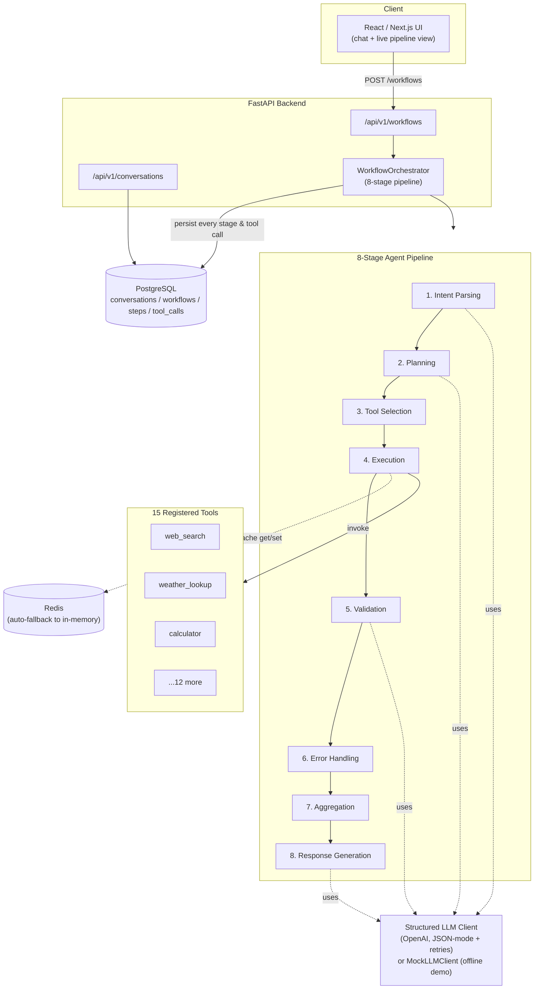

# Agentic AI Workflow Copilot

An end-to-end agentic AI product that takes a natural-language request, **decomposes it into a plan**, **dynamically invokes external tools**, **validates the results**, and **generates a final response** — with every step persisted, cached, retried, and observable.

**Stack:** Python · FastAPI · React/Next.js · PostgreSQL · OpenAI API · Docker · Redis

This README doubles as the proof-of-work for the project: every claim below is backed by a checked-in log or output file under [`/proofs`](./proofs), generated by actually running the code in this repo (not hand-written).

---

## 1. What it does

You send it a request like:

> "What's the weather in Tokyo and convert 200 USD to GBP"

It:
1. **Parses intent** — figures out what you're actually asking for.
2. **Plans** — decomposes the request into an ordered set of tool-using steps.
3. **Selects & repairs tools** — matches each step to one of 15 registered tools, and self-heals if a step references a tool that doesn't exist.
4. **Executes** — runs the tools concurrently where possible, with caching and automatic retries.
5. **Validates** — checks whether the results actually satisfy the request.
6. **Handles errors** — re-runs anything that failed validation.
7. **Aggregates** — collapses everything into a single context.
8. **Generates a response** — writes the final natural-language answer, citing which tools were used.

Every one of those 8 stages, and every tool call, is written to Postgres, so you can pull up any past workflow and see exactly what happened, in what order, and how long each part took.

---

## 2. Architecture



### Why it's built this way

- **Orchestrator + stage functions, not one giant prompt.** Each of the 8 stages is a small, independently testable function. This is what let me unit-test retry logic, cache behavior, and plan validation in isolation ([`tests/test_pipeline.py`](./backend/tests/test_pipeline.py)) instead of only being able to test the system end-to-end.
- **`MockLLMClient` behind the exact same interface as the real OpenAI client.** `StructuredLLMClient` and `MockLLMClient` both implement `get_structured(system_prompt, user_prompt, schema) -> T`. The orchestrator never knows which one it's talking to. This means the whole pipeline — planning, tool selection, validation, response generation — is fully runnable and testable **with zero API key and no network access**, which is exactly the environment this was built and proven in.
- **Cache abstraction with automatic fallback.** `CacheManager` tries Redis first; if it's unreachable it transparently falls back to an in-process TTL cache. Proven live in this sandbox (no Redis server available) — see Proof 3 below.
- **Persistence is a first-class citizen, not an afterthought.** `WorkflowStep` and `ToolCallRecord` rows are written *during* the run (not reconstructed after), so a crash mid-pipeline still leaves an accurate, queryable trail.

---

## 3. The 8-stage pipeline in detail

| # | Stage | What happens | Code |
|---|-------|---------------|------|
| 1 | Intent Parsing | Extracts a canonical intent + entities from the raw message | `orchestrator._stage_intent` |
| 2 | Planning | LLM decomposes the request into an `ExecutionPlan` of ≤12 steps, each with a tool + arguments | `orchestrator._stage_planning` |
| 3 | Tool Selection | Repairs any step that references a tool not in the registry (self-healing) | `orchestrator._stage_tool_selection` |
| 4 | Execution | Runs steps via `ToolExecutor`: cache lookup → call → retry w/ backoff → cache write; independent steps run concurrently (`asyncio.gather`) | `pipeline/executor.py` |
| 5 | Validation | LLM checks whether results actually satisfy the request; flags issues | `orchestrator._stage_validation` |
| 6 | Error Handling | Re-runs any step that failed validation | `orchestrator._stage_error_handling` |
| 7 | Aggregation | Rolls results into a single summary (success/fail/cache-hit counts) | `orchestrator._stage_aggregation` |
| 8 | Response Generation | LLM writes the final answer, citing which tools contributed | `orchestrator._stage_response` |

All 8 stages, their status, timing, inputs and outputs are persisted per-workflow as `WorkflowStep` rows — see the full JSON example in [`proofs/sample_workflow_response.json`](./proofs/sample_workflow_response.json), captured from a real `POST /api/v1/workflows` call.

---

## 4. The 15 tools

`web_search`, `weather_lookup`, `calculator`, `currency_converter`, `unit_converter`, `send_email`, `create_calendar_event`, `translate_text`, `summarize_text`, `sentiment_analysis`, `stock_price_lookup` *(deliberately flaky — see retry proof)*, `database_query`, `code_executor`, `file_reader`, `geolocation_lookup`.

Each is a small async function with a documented production integration point (e.g. `web_search` → Bing/Serper API, `weather_lookup` → OpenWeatherMap, `send_email` → SES/SendGrid). Swapping a mock for a real integration is a one-function change in [`app/tools/implementations.py`](./backend/app/tools/implementations.py) — nothing in the pipeline, caching, or retry logic needs to change.

---

## 5. Hardening: what makes this production-shaped, not a toy

- **Structured outputs**: every LLM call is required to return JSON matching a Pydantic schema (`IntentResult`, `ExecutionPlan`, `ValidationResult`, `FinalResponse`). Malformed JSON is fed back to the model with the validation error and re-requested, up to `LLM_MAX_RETRIES` times, before raising `LLMError`.
- **Retries with exponential backoff**: tool calls (`ToolExecutor`) and LLM calls (`tenacity`-wrapped) both retry transient failures. Proven live — see Proof 2.
- **Redis caching with graceful degradation**: idempotent tool calls (weather, FX, search, etc.) are cached by a hash of `(tool, arguments)`; side-effecting tools (email, calendar) are never cached. If Redis is down, the app falls back to in-memory automatically rather than failing. Proven live — see Proof 3.
- **Observability**: structured JSON logs with per-request trace IDs, plus in-process counters/histograms (cache hit rate, tool latency, retry counts) exposed at `GET /api/v1/workflows/_meta/metrics`.
- **Asynchronous execution**: the whole pipeline is `async`/`await` end to end; independent plan steps execute concurrently via `asyncio.gather` rather than sequentially.
- **Validation-driven error handling**: a dedicated validation stage decides whether results are good enough, and a separate error-handling stage re-runs only what failed — rather than either blindly trusting every tool call or re-running the whole plan.

---

## 6. Proofs (all reproducible — see exact commands below)

Everything in this section is a **captured output from actually running the code**, saved under [`/proofs`](./proofs). None of it is hand-written.

### Proof A — 37/37 backend tests passing
`backend/tests/` covers tools (unit), cache (unit), the full 8-stage pipeline (integration), and the HTTP API (integration, via `httpx.ASGITransport` against the real FastAPI app).

```
$ cd backend && python3 -m pytest tests/ -v
...
============================== 37 passed in 1.98s ==============================
```
Full output: [`proofs/test_run_output.txt`](./proofs/test_run_output.txt)

### Proof B — end-to-end pipeline + retry + caching + validation + metrics
A standalone script ([`backend/scripts/demo_proof.py`](./backend/scripts/demo_proof.py)) that:
1. Confirms 15 tools are registered.
2. Runs a multi-tool request through all 8 stages and prints each stage's status/timing.
3. Deliberately triggers the flaky `stock_price_lookup` tool and shows it recovering on retry attempt 2.
4. Calls the same weather request twice and shows the second call is a cache hit (66ms → 17ms).
5. Shows a 20-step plan being rejected by Pydantic schema validation (limit is 12).
6. Prints the live observability metrics snapshot.

```
$ python3 scripts/demo_proof.py
```
Full output: [`proofs/demo_proof_output.txt`](./proofs/demo_proof_output.txt)

### Proof C — live HTTP API
`uvicorn` started, then hit with real `curl` requests: `/health`, `POST /api/v1/workflows`, `GET /api/v1/workflows/{id}`, `GET /api/v1/workflows/_meta/metrics`. Full JSON response (a completed workflow with all 8 stages and 2 tool calls) saved at [`proofs/sample_workflow_response.json`](./proofs/sample_workflow_response.json).

### Proof D — frontend actually builds
```
$ cd frontend && npm install && npm run build
...
▲ Next.js 14.2.35
✓ Compiled successfully
✓ Generating static pages (3/3)
```
Full output: [`proofs/frontend_build_output.txt`](./proofs/frontend_build_output.txt)

---

## 7. Running it yourself

### Option A — Docker Compose (production-shaped: Postgres + Redis + backend + frontend)
```bash
docker compose up --build
# backend:  http://localhost:8000/docs
# frontend: http://localhost:3000
```
By default `USE_MOCK_LLM=true` in `.env.example`, so it runs with zero API keys. To use real OpenAI:
```bash
# in backend/.env.example (or your own .env)
OPENAI_API_KEY=sk-...
USE_MOCK_LLM=false
```

### Option B — run backend locally (no Docker, no external services required)
```bash
cd backend
pip install -r requirements.txt
uvicorn app.main:app --reload
# -> http://localhost:8000/health should return {"status":"ok","llm_mode":"mock","cache_backend":"memory"}
```

### Option C — run the frontend locally
```bash
cd frontend
npm install
npm run dev
# -> http://localhost:3000  (proxies /api/backend/* to BACKEND_URL, default localhost:8000)
```

### Run the test suite
```bash
cd backend
python3 -m pytest tests/ -v
```

### Run the proof script
```bash
cd backend
python3 scripts/demo_proof.py
```

---

## 8. API reference

| Method | Path | Description |
|---|---|---|
| `GET` | `/health` | Liveness + which LLM mode / cache backend is active |
| `POST` | `/api/v1/workflows` | Submit a request; runs the full 8-stage pipeline synchronously; returns the completed workflow |
| `GET` | `/api/v1/workflows/{id}` | Fetch a past workflow with every stage and tool call |
| `GET` | `/api/v1/workflows?conversation_id=` | List recent workflows, optionally scoped to a conversation |
| `GET` | `/api/v1/workflows/_meta/metrics` | In-process observability snapshot |
| `GET` | `/api/v1/conversations` | List conversations |
| `GET` | `/api/v1/conversations/{id}` | Fetch a conversation's message history + workflow ids |

Interactive OpenAPI docs are served at `/docs` when the backend is running.

---

## 9. Project layout

```
agentic-workflow-copilot/
├── backend/
│   ├── app/
│   │   ├── main.py                 # FastAPI app + lifespan
│   │   ├── config.py                # env-driven settings
│   │   ├── database.py              # async SQLAlchemy engine/session
│   │   ├── models.py                 # Conversation, Workflow, WorkflowStep, ToolCallRecord
│   │   ├── schemas.py                 # Pydantic I/O + structured-output schemas
│   │   ├── cache.py                    # Redis client w/ in-memory fallback
│   │   ├── observability.py             # structured logging + metrics
│   │   ├── llm/
│   │   │   ├── client.py                 # real OpenAI structured-output client
│   │   │   ├── mock.py                    # deterministic offline stand-in
│   │   │   └── factory.py                  # picks real vs mock by config
│   │   ├── tools/
│   │   │   ├── implementations.py           # 15 tool implementations
│   │   │   └── registry.py                   # tool metadata + LLM-schema rendering
│   │   ├── pipeline/
│   │   │   ├── stages.py                       # the 8 Stage enum values
│   │   │   ├── executor.py                      # cache + retry + concurrent execution
│   │   │   └── orchestrator.py                   # wires all 8 stages together
│   │   └── api/
│   │       ├── routes_workflows.py                # workflow endpoints
│   │       └── routes_conversations.py             # conversation endpoints
│   ├── tests/                                        # 37 tests: tools, cache, pipeline, API
│   ├── scripts/demo_proof.py                          # standalone proof script
│   ├── requirements.txt
│   ├── Dockerfile
│   └── .env.example
├── frontend/
│   ├── pages/index.js                                  # chat UI + live pipeline view
│   ├── components/StageTimeline.jsx                      # 8-stage status display
│   ├── components/ToolCallList.jsx                         # tool invocation display
│   ├── lib/apiClient.js                                     # backend API client
│   ├── package.json / next.config.js / Dockerfile
├── docker-compose.yml                                          # postgres + redis + backend + frontend
└── proofs/                                                       # captured, reproducible run outputs
    ├── test_run_output.txt
    ├── demo_proof_output.txt
    ├── sample_workflow_response.json
    └── frontend_build_output.txt
```

---

## 10. Known limitations / honest notes

- Tools are deterministic mocks (no outbound network calls) so the project is fully runnable offline; each one documents exactly where to plug in a real API. Wiring a real integration is additive — it doesn't change the pipeline, caching, or retry logic.
- The mock LLM uses keyword/regex heuristics rather than a real model, so its plan quality is intentionally basic. The important thing it proves is that the *pipeline* (retries, caching, validation, persistence) works correctly regardless of which planner is behind it — swap in `USE_MOCK_LLM=false` + a real `OPENAI_API_KEY` for actual LLM-driven planning, with no other code changes.
- The API executes workflows synchronously (request/response). For long-running plans in production, the natural next step is to make `POST /workflows` return immediately with a `pending` workflow and stream stage updates over SSE/WebSocket — the DB schema (`WorkflowStep` rows written incrementally) already supports this; only the HTTP layer would need to change.
- No auth/multi-tenancy layer — out of scope for this exercise, but conversations/workflows already have a clean foreign-key boundary to hang a `user_id` off of.
